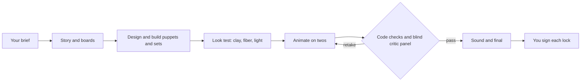

# Clay Studio

**A stop-motion studio you run from Claude Code.** Claude agents are the crew: director, animators, look development, sound, QC. Blender is the stage, driven entirely from code. You are the executive producer, and nothing locks without your sign-off.

This isn't a video generator. Every frame is a real 3D scene with real puppets, real lights and a real camera, so you can re-pose, relight, re-time and re-render any shot. The handmade feel is built in on purpose: poses held on twos, wool fibers you can see, surfaces that "boil" between frames, a set that breathes.

> **Status: v0.5, early and honest.** The studio's operating model, research and measurements are done, and the first working tools are here: a pinned Blender 5.2 pipeline, render benchmarks, and a character pipeline that takes a puppet from description to a rigged figure that walks, smiles and waves. The full plugin (`/clay-studio:make <brief>`) is being built in the open. See [Roadmap](#roadmap).

## Why it's different

**It's organized like a real studio, not a prompt.** Stop motion can't be fixed in post; a bad shot gets reshot. So real studios approve the cheap things first (script, boards, animatic, a camera and light test, a rough pose pass) and give every shot one accountable owner. Clay Studio is designed the same way: eight locks (Script, Design, Animatic, Voice, Look, Picture, Sound, Final), one owner per deliverable, and makers never approve their own work. The full org, with roles, gates, notes and accountability, is in [`studio/STUDIO_BIBLE.md`](studio/STUDIO_BIBLE.md).

**It measures instead of guessing.** We cataloged 199 openly licensed clay films and measured 35 of them frame by frame: how many new poses a second, how often frames are held, contrast, sharpness. One early surprise: there is no single "clay cadence." Real clay runs anywhere from 8 to 30 poses a second, and only a quarter of clips are mostly on twos. Those numbers become code checks our renders have to pass ([`research/16`](research/16-public-clay-measured.md), [`gold/`](gold/)).

**Quality will be judged blind, with guards against gaming.** The design: a critic panel of three model families compares our frames against real clay in blind pairs, on six dimensions from clay surface to performance. A hidden judge and real human raters check the panel, and the tuning loop stops itself if scores rise while humans disagree ([`research/04`](research/04-eval-harness.md), [`studio/GOLD_SET.md`](studio/GOLD_SET.md)).

**It has taste written down.** Real textures, fibers and earthy materials, tied together by a single fiber that runs through every film like a maker's mark ([`studio/CREATIVE_DIRECTION.md`](studio/CREATIVE_DIRECTION.md)).

## What already works

| | Result |
|---|---|
| **Blender from code** | Pinned Blender 5.2 LTS as a Python module, with an API smoke test that checks the 5.x APIs models often get wrong. Headless EEVEE and Cycles on Apple Silicon (Metal). |
| **Measured render costs** | On an M4 Pro laptop: a rough pose pass takes 1.5 s a frame; a 1080p clay-and-wool close-up takes 42 s at review quality and 161 s at final ([`studio/ENVIRONMENT.md`](studio/ENVIRONMENT.md)). A 15-second film on twos is about 180 unique frames. |
| **Characters with real anatomy** | Three approaches tested side by side. The winner: design the character in 2D first, turn the design into a 3D sculpt, then bring it into the studio's own materials and wool. About $2 to $4 and a few minutes per character ([`research/19`](research/19-character-pipeline-experiments.md)). |
| **Characters that move** | A skeleton placed from the mesh's own proportions, planted feet with leg IK, a smile control, a rigid head so the wool beard never slides, joints that relax instead of crumpling. First performance: a 6-second walk-in, smile and wave, on twos ([`tools/puppet/`](tools/puppet/)). |
| **The plan to build the rest** | One kickoff prompt that takes Claude Code through research, spec, independent spec review, build, calibration, a tuning loop and a pilot film, stopping at each gate for your sign-off ([`KICKOFF_PROMPT.md`](KICKOFF_PROMPT.md)). |

## How a film gets made



Cheap previews are approved before expensive renders, every shot has one owner, and nothing locks without your sign-off.

## Start here

1. Read the setup notes at the top of [`KICKOFF_PROMPT.md`](KICKOFF_PROMPT.md): what you need (a GPU or Apple Silicon Mac, a small budget for judge calls) and the questions it will ask you.
2. Open Claude Code in this repo and paste the prompt. It works through the phases and stops at every gate.

While the plugin is in development, install it locally from this repo:
```
claude plugin marketplace add ./
claude plugin install clay-studio@clay-motion
```

## What's inside

| Path | What it is |
|---|---|
| [`KICKOFF_PROMPT.md`](KICKOFF_PROMPT.md) | The prompt that has Claude Code build and tune the studio |
| [`studio/`](studio/) | The operating model: the studio bible, creative direction, which Claude model and feature does each job, and design docs for story, world, fabrication, look development, motion, sound and engineering |
| [`research/`](research/) | 18 sourced reports: studio craft, roles, pipelines, clay shading, camera and light, sound, evaluation, measured public footage, how the best studios work, and our character experiments |
| [`gold/`](gold/) | 199 openly licensed clay clips cataloged, a curated shortlist, and per-clip measurements |
| [`tools/`](tools/) | Working R&D scripts: clip measurement, look stats, the clay test scene, and the puppet pipeline |
| [`lib/`](lib/), [`bin/`](bin/), [`hooks/`](hooks/) | The plugin's first pieces: Blender smoke test, render benchmark, the `studio` command, session hooks |
| [`reviews/`](reviews/) | Independent reviews of the kit and how each finding was resolved |
| [`templates/`](templates/) | Agent file template and a worked Director example |

## Roadmap

- [x] Operating model, research, measured gold set, kickoff prompt
- [x] Pinned Blender pipeline, smoke test, render benchmarks, plugin skeleton
- [x] Character pipeline: design, 3D sculpt, studio look, rig, first performance
- [ ] Research refresh and full spec, reviewed by six independent critics
- [ ] The `studio` tracker CLI, code QC checks, the animation engine, look development
- [ ] Calibrated critic panel and human A/B ratings against the gold set
- [ ] First pilot film through all eight locks
- [ ] `/clay-studio:make <brief>` from a public marketplace

## Ground rules we hold ourselves to

- **Honest numbers.** Nothing is called studio-grade without blind evidence against a named gold set. Guesses are marked as guesses.
- **Original work only.** Original characters, worlds and stories. No lookalikes of existing films or characters.
- **Licenses checked.** Every model, add-on, texture, sound and font is checked and logged before use.
- **Your data stays yours.** Keys never touch the repo. Photos of real people are never sent to a generation service without the person's say-so, and generated likenesses stay out of this public repo.

## License

Not chosen yet. Code that imports Blender's Python module may fall under Blender's GPL, so the license will be picked with that in mind before the first release. Until then, all rights reserved.
